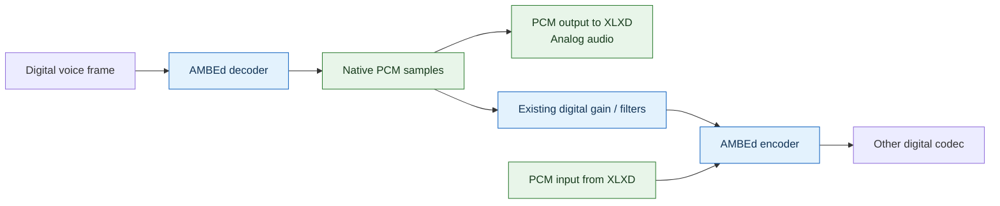
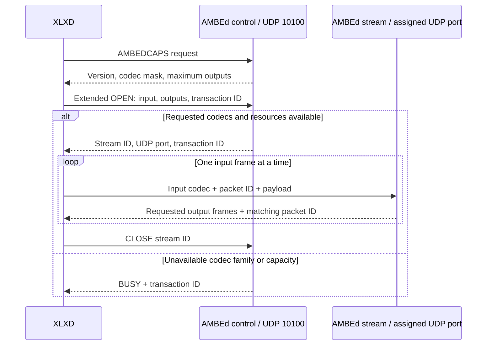

# Negotiated PCM transport

PCM support lets XLXD exchange decoded audio with AMBEd alongside digital
voice frames. An analog endpoint can send audio for encoding, or receive
decoded audio, through the same transcoder connection used for digital voice.
XLXD routes streams and AMBEd performs the codec conversion.

## Audio paths



A stream has one input codec and up to four distinct output codecs. For
example, a digital input can produce both PCM and another digital codec.
The input codec is excluded from the output list: XLXD retains the original
frame rather than asking AMBEd to encode it again.

PCM output uses the decoder's native samples before digital-route gains and
filters. PCM input uses unity gain. Existing digital-to-digital processing
remains in place, including route-specific gain and filtering.

## PCM format

Codec ID **5** identifies one fixed format; no sample-rate negotiation or
resampling is performed.

| Property | Value |
| --- | --- |
| Sample encoding | Signed 16-bit linear PCM, little-endian (S16LE) |
| Sample rate | 8000 Hz |
| Channels | 1 (mono) |
| Samples per frame | 160 |
| Frame duration | 20 ms |
| PCM payload size | 320 bytes |

PCM is a sample format, not A-law or mu-law. USRP is a separate transport;
its header and PTT signaling are not part of the AMBEd PCM payload.

The existing codec IDs retain their meaning:

| ID | Format | Payload bytes per input frame |
| --- | --- | --- |
| 1 | AMBE+ (D-Star) | 9 |
| 2 | AMBE+2 (DMR) | 9 |
| 3 | Codec2 | 8 |
| 4 | IMBE | 11 |
| 5 | PCM S16LE, 8000 Hz mono | 320 |

## Capability discovery and stream setup

XLXD probes the backend before requesting an extended stream. The control
exchange uses UDP port 10100 and a separate client control socket. Replies
carry a transaction ID so concurrent OPEN requests can be matched correctly.



A capability mask describes supported format IDs, not a reservation of
hardware. OPEN can still return BUSY when a selected device cannot serve the
requested AMBE family or all available streams are occupied. A failed OPEN
does not publish a partially initialized stream.

The legacy OPEN and data layouts remain unchanged. Existing digital callers
continue to use the legacy path. Extended requests require capability support;
an older backend cannot supply PCM. XLXD retains native codec data when PCM
conversion is unavailable, and PCM is not carried over XLX interlinks.

## Running AMBEd

The original invocation keeps the existing hardware-discovery behavior:

```sh
ambed 127.0.0.1
```

For software Codec2/IMBE conversions and PCM input or output, without hardware
discovery:

```sh
ambed 127.0.0.1 --software-only
```

For a single-channel DVstick30, select its serial number and one AMBE family.
Replace `YOUR_DEVICE_SERIAL` with the actual device serial:

```sh
ambed 127.0.0.1 --device-serial YOUR_DEVICE_SERIAL --device-profile dvstick30 --device-codec 1
```

Use `--device-codec 1` for D-Star or `--device-codec 2` for DMR. These are
alternative device configurations. The selected device supports one
hardware-backed extended stream at a time; it does not provide simultaneous
D-Star and DMR conversion. Software-only streams can run alongside that
hardware-backed stream. The extended path admits up to 26 software streams.

The explicit software-only and selected-device modes bypass the legacy
hardware pool. Do not combine `--software-only` with `--device-serial`.
AMBE conversion in the extended path requires the explicit selected-device
configuration; ordinary legacy device discovery does not supply that resource.

A device transfer timeout makes the affected stream unusable until it is
closed and reopened, because device responses have no transaction tags.

## Wire format reference

All sizes below are UDP payload sizes. Capability masks and transaction IDs
are unsigned 32-bit values in network byte order. The stream ID and port in
the descriptor retain the legacy native-endian 16-bit representation; PCM
samples are always little-endian.

| Message | Bytes | Contents |
| --- | --- | --- |
| Capability request | 9 | `AMBEDCAPS` |
| Capability reply | 15 | Tag, version (1), maximum outputs (1), codec mask (4) |
| Extended OPEN | 24 | `AMBEDOS`, callsign (8), input codec (1), output codecs (4), transaction ID (4) |
| Stream descriptor | 18 | `AMBEDSTD`, stream ID (2), port (2), input codec (1), first output codec (1), transaction ID (4) |
| BUSY | 13 | `AMBEDBUSY`, transaction ID (4) |
| CLOSE | 9 | `AMBEDCS`, stream ID (2) |

Unused OPEN output slots are zero. Requested outputs must be distinct, valid
codec IDs and different from the input codec. Codec-mask bit `n` represents
codec ID `n`.

Input data contains `codec ID (1) + packet ID (1) + payload`. A PCM input
therefore occupies 322 bytes. Output data contains the first codec ID, one
packet ID, and its payload, followed by each additional codec ID and payload
in the requested order. There is only one packet ID per reply. For example,
a PCM-only output reply is also 322 bytes.

XLXD and AMBEd keep their wire helpers locally in `src/pcm_protocol.h` and
`ambed/pcm_protocol.h`, respectively.
