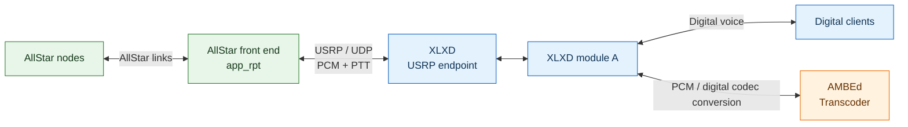
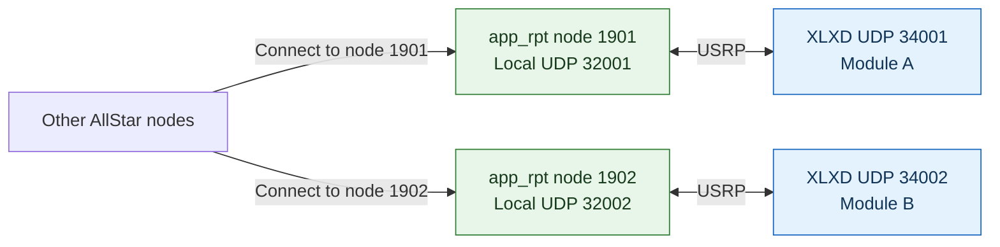
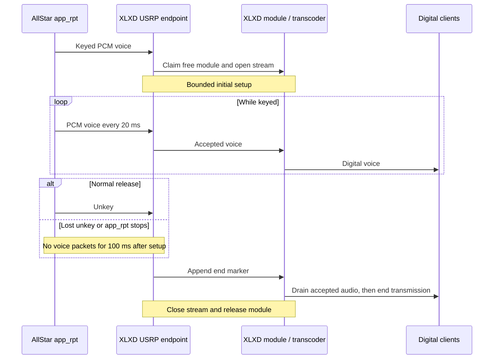

# Module-bound USRP endpoints

USRP connects an analog front end, such as AllStar app_rpt, directly to an
XLXD module using PCM audio and PTT signaling over UDP. AMBEd provides codec
conversion for digital clients; no separate audio-conversion bridge is needed.

## How the pieces connect



AllStar manages its node links. XLXD sees a configured USRP peer and routes
its audio through the assigned module. The transcoder converts between PCM
and the codecs needed by connected digital clients. Audio can flow in either
direction; the module's first talker owns the stream.

## Map front-end nodes to modules

Install selected rows from [config/xlxd.usrp.example](../config/xlxd.usrp.example)
as `/xlxd/xlxd.usrp`. Each row binds
one module to one fixed IPv4 UDP peer. Only configured ports open; a missing
or empty file keeps the existing twelve protocols. Invalid or duplicate rows
fail startup. The USRP protocol ID is 13; its audio codec ID is 5.

The following mapping uses separate front-end nodes and UDP port pairs for
modules A and B. Node 1902 is a second configuration example, not an automatic
node assignment.



| Front-end node | app_rpt local UDP port | XLXD UDP port | Module |
| --- | --- | --- | --- |
| 1901 | 32001 | 34001 | A |
| 1902 | 32002 | 34002 | B |

Ports and modules are explicitly configured; XLXD does not automatically open
26 consecutive ports. Multiple AllStar callers reach a module through its
front-end node, rather than each becoming a separate USRP peer.

For module A, the matching row in `xlxd.usrp` is:

```text
# module bind_ip bind_port peer_ip peer_port source_callsign
A 127.0.0.1 34001 127.0.0.1 32001 N0CALL
```

On the same host, app_rpt uses:

```ini
[1901]
rxchannel = USRP/127.0.0.1:34001:32001
duplex = 0
hangtime = 0
telemdefault = 0
```

AllStar callers connect to the front-end node number, here 1901. The mapping
to XLXD module A is static configuration. XLXD needs no AllStar node database,
registration, discovery, or module-selection signaling. The peer tuple must
match exactly, including its UDP source port.

## Audio format

USRP voice contains a 32-byte header of network-order fields and 320 bytes
of signed 16-bit little-endian, 8000 Hz mono PCM. Each frame represents 20 ms.
Keyed zero samples are valid voice. Idle endpoints send no voice. This
fixed-channel implementation accepts voice and header-only unkey, rejects
unexpected sources and malformed packets, and drops duplicate/late sequence
numbers with wrap handling. It does not interpret text, DTMF, or talkgroups.

## PTT and stream release

The sequence below shows an AllStar caller sending into a free module.
The inactivity timer applies after initial stream setup. It detects missing
voice packets, not silence in the audio samples.



The module's first talker owns the stream. A losing ingress remains suppressed
until unkey or 100 ms quiet; it cannot join in the middle of a transmission.
Unkey or inactivity appends an end marker after accepted voice. Shared
transcoder/playout drains through the existing bounded close path. Per-room
workers isolate opening and draining from other endpoints. Egress holds at
most two frames, drops residence above 40 ms, and paces at 20 ms. A missing
frame may produce keyed silence for at most 100 ms before unkey.
Fresh PCM can rekey the same still-open stream after that gap; End retires
the stream. RX busy suppression is a separate first-talker policy.

## Setup and buffering

Extended control has a single receive dispatcher and per-transaction waits,
so a delayed OPEN does not hold the shared state lock against another OPEN
or CLOSE. Each extended control request has an overall 1400 ms setup budget.
The endpoint receives queued voice/unkey after its own synchronous setup;
the 100 ms media inactivity threshold is not an end-to-end startup deadline.

An extended stream freezes bounded startup headroom at its first playout
(observed initial occupancy plus two slots, capped at 800 ms). This preserves
the accepted device-open backlog when the adaptive target later shrinks.
Legacy jitter constants and overrun behavior remain unchanged.

## Codec routing

On configured modules, transcoder outputs follow actual connected-client
codec demand. Native codec data is retained when the backend is absent or
cannot provide PCM. No empty codec slots are manufactured. Digital-only
modules retain their existing demand policy, and PCM is not added to the
XLX interlink wire. The optional PCM packet storage carries source provenance
to suppress a source endpoint's own delayed tail.

## AllStar behavior and radio PTT

The referenced AllStar chan_usrp does not treat a received header-only unkey as
an immediate radio-unkey acknowledgment. Its receive queue and four-write-tick
countdown determine remote release. Keep telemetry disabled in isolated
audio tests so app_rpt announcements are not mistaken for bridged speech.
One XLXD process can configure 26 endpoints; this AllStar version has a
16-USRP-channel limit per Asterisk instance.

After initial OPEN completes, an app_rpt source that stops emitting USRP
voice triggers XLXD's 100 ms inactivity watchdog even if unkey was lost.
Initial control setup may use the bounded setup budget described above.
Logical room release does not guarantee release of
an external radio's GPIO/USB PTT after its controlling process dies. Such
hardware needs its own timeout/watchdog for that guarantee. Continuous keyed
silence remains valid voice and does not expire the inactivity timer.

## References

IAX2 reference (AllStar links): [RFC 5456](https://www.rfc-editor.org/rfc/rfc5456).
AllStar reference: [app_rpt 3.10.8](https://github.com/AllStarLink/app_rpt/tree/d3929751f102c37b3c8b4e1b0040ec19d907cfea),
especially channels/chan_usrp.c, apps/app_rpt.c and apps/app_rpt/app_rpt.h.
